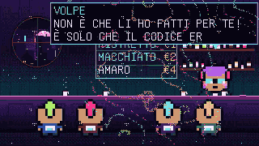
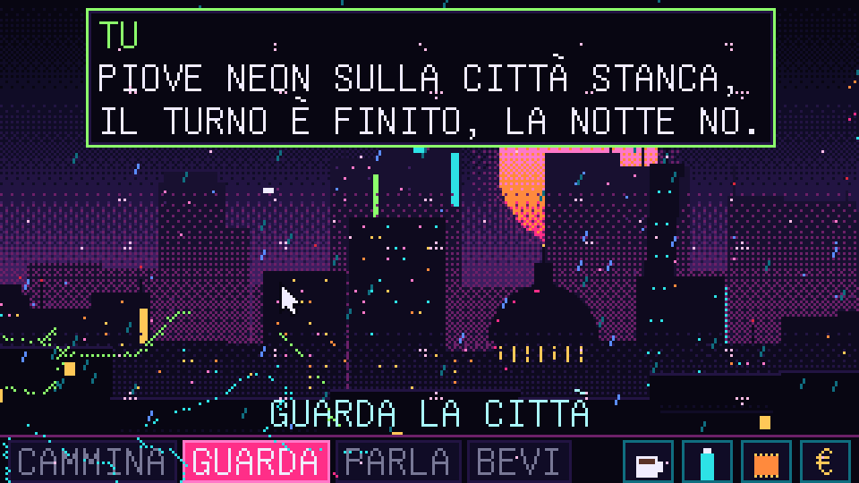
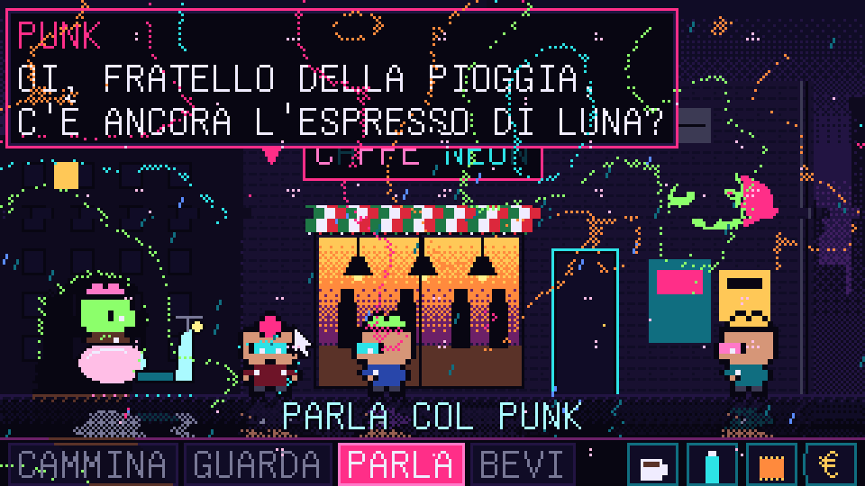
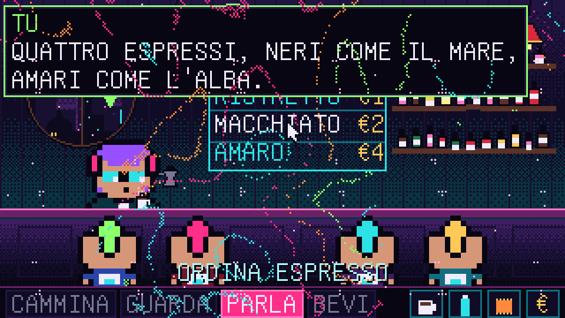
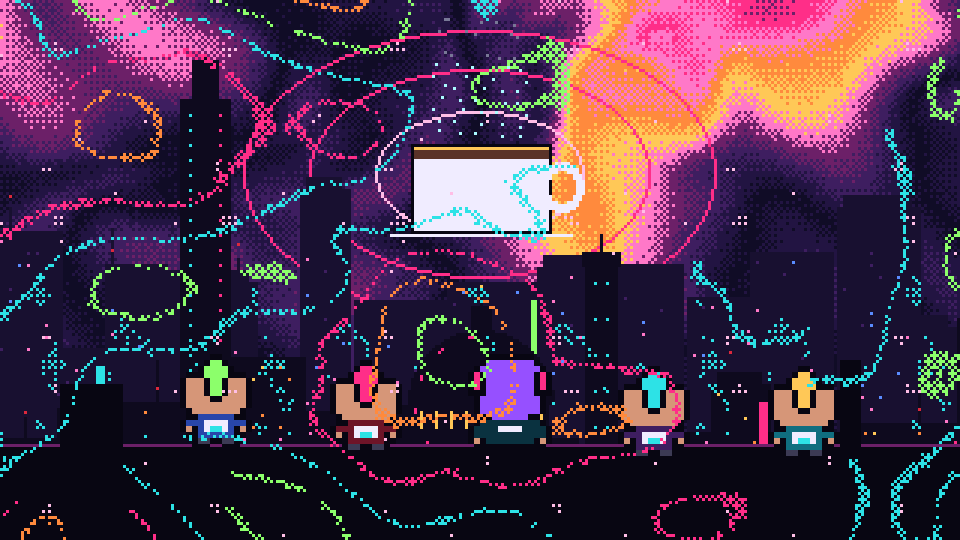

# Neon Arpeggio

**An 8-bit point-and-click music video, drawn entirely in code.**
Music by AV Medicine Show.



▶ **[Play it in your browser](https://projectionheart.github.io/neon-arpeggio/)**: click the verbs and the scene to jump through the night.

---

Rain falls on a neon Italian city of the future. A night-shift worker heads to Caffè Neon, where a crew of mohawked hooligans waits outside and Volpe, a tsundere hacker, works the espresso machine. Four espressos later, the walls start breathing.

There is no footage, no editing timeline and no drawing program. Every one of the 2,017 frames is generated by `render.py` at 320×180 pixels in a fixed 32-colour palette, timed to the song's beat.

| | |
|---|---|
|  |  |
|  |  |

## Run it

Needs Python 3.10+ and [ffmpeg](https://ffmpeg.org/) on your PATH.

```bash
pip install -r requirements.txt
python render.py                      # out/neon_arpeggio.mp4, 1920x1080
```

Other modes:

```bash
python render.py --clean --scale 2 --crf 32 --preset medium docs/neon_arpeggio_web.mp4   # video for the web player
python render.py out/still --stills 5 22 36.5 60.5                                      # PNG stills
python analyze.py path/to/another_song.m4a                                              # tempo + first beat of a new song
```

A full render takes a couple of minutes on one CPU core.

## How it works

**Listening to the song.** `analyze.py` decodes the audio with ffmpeg and runs a short-time Fourier transform. It tracks three envelopes:

- bass energy (30–150 Hz)
- hi-hat and arpeggio energy (4–11 kHz)
- spectral flux, which marks note onsets

Autocorrelating the onsets, then grid-searching tempo and phase, gives the beat grid: **140.82 BPM**, first beat at 0.135 s.

**Reacting to it.**

- Neon letters chase the beat, and the characters bob on it.
- The espresso moon pulses on the downbeat.
- Bass kicks split the red and blue channels.
- Onsets trigger row tears and *datamosh* blocks copied from the previous frame.
- City windows flicker with the arpeggio.

**Scenes.** Five scenes are cut on the song's sections:

| Time | Verb | Scene |
|---|---|---|
| 0:00 | GUARDA | Painted rainy skyline with parallax layers, a neon duomo and a leaning campanile |
| 0:14 | CAMMINA | Storefront of Caffè Neon: tricolore awning, hover-Vespa, graffiti growing on the wall |
| 0:30 | PARLA | Inside the bar: Volpe pours for four punks |
| 0:42 | BEVI | The espresso hits and the walls breathe |
| 0:53 | | Breakdown, then a dream on the rooftop under a plasma sky |

**The 8-bit look.**

- Everything is quantised to one 32-colour palette.
- Gradients, fog, halos and fades use a 4×4 **Bayer matrix** (ordered dithering). The fade to black is a Bayer dissolve.
- Sprites are 16×16 text grids in a Game Boy overworld style, recoloured per character. Volpe has extra faces: pout, eyes-away, blush and an anime anger mark.
- The text is GNU Unifont, a real bitmap font.

**Organic textures.** Tileable value noise is *domain-warped* (noise used to bend the coordinates of more noise). Thin bands of it become drifting contour lines, and its peaks become colour-rotated blobs and spores. The overlay starts faint and takes over during the trip. The final sky is a classic demoscene **plasma**: the same warped noise, palette-cycled.

## The playable page

`docs/index.html` is a single file with no libraries. It plays a version of the video rendered with `--clean`, which has no cursor or menu baked in, and draws a live verb bar, inventory and pixel cursor over it.

- The verbs jump between scenes.
- Hotspots in the picture react to clicks: the BAR sign, the door, the punk, Volpe (who follows her own path along the counter), the menu, the espresso cups and the moon.
- Keys: `1`–`4` pick a verb, `space` pauses, `R` restarts.

To host it, turn on GitHub Pages for the `docs/` folder on the main branch.

## Il copione

| | Italiano | English |
|---|---|---|
| TU | Piove neon sulla città stanca, il turno è finito, la notte no. | Neon rains on the tired city; the shift is over, the night is not. |
| TU | C'è un bar dove il tempo si ferma, dove il caffè sa di stelle. | There's a bar where time stands still, where the coffee tastes of stars. |
| PUNK | Oi, fratello della pioggia, c'è ancora l'espresso di luna? | Oi, brother of the rain, is there still moon espresso? |
| TU | Solo chi entra lo saprà, e chi beve non torna uguale. | Only those who enter will know, and whoever drinks won't come back the same. |
| VOLPE | Che volete? Non ho tempo per voi… ma la notte è lunga. Sedetevi. | What do you want? I've no time for you… but the night is long. Sit down. |
| TU | Quattro espressi, neri come il mare, amari come l'alba. | Four espressos, black as the sea, bitter as the dawn. |
| VOLPE | Non è che li ho fatti per te! È solo che il codice era caldo. | It's not like I made them for you! The code was just warm, that's all. |
| PUNK | Oh… i muri respirano, e il neon canta in minore. | Oh… the walls are breathing, and the neon sings in minor. |
| VOLPE | Ogni sorso è un sogno, scemo… e non ringraziarmi. Mai. | Every sip is a dream, idiot… and don't thank me. Ever. |

## Repository

```
render.py               generator: scenes, sprites, effects, encoding
analyze.py              audio analysis: envelopes and beat grid
assets/song.m4a         the 67-second excerpt of the song
assets/unifont-latin.otf  pixel font (Latin subset of GNU Unifont)
docs/                   playable page, web video, preview GIF, stills
```

## Credits and licence

- Music, concept and art direction: **AV Medicine Show**. The song (`assets/song.m4a`) and the rendered video are © AV Medicine Show, all rights reserved.
- Code: MIT licence, see [LICENSE](LICENSE).
- Font: [GNU Unifont](https://unifoundry.com/unifont/), SIL Open Font License 1.1.
